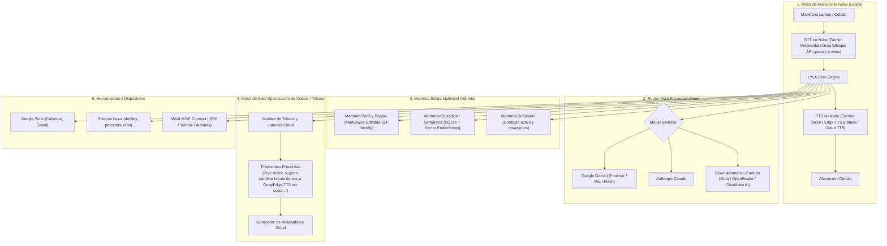

# LYLA // Agente Inteligente Autónomo y Evolutivo (Spider-Man 2099)

## 1. Visión del Sistema
LYLA es un agente asistente con personalidad propia que opera **100% en la nube** (sin desgastar CPU/GPU local). Monitorea el consumo de tokens y latencia para **auto-proponer optimizaciones a otros proveedores cloud** (Groq Whisper, Edge-TTS, OpenRouter, Claude, Gemini Free Tier), pidiendo confirmación a Víctor antes de implementar o cambiar la configuración.

---

## 2. Arquitectura de Módulos (Cloud-First & Zero Hardware Impact)

---

## 3. Arquitectura de Memoria Sólida (Estrategia Híbrida Recomendada)

Para que LYLA tenga una memoria robusta, persistente y económica en tokens sin consumir recursos locales significativos, se implementa una **arquitectura híbrida en 3 capas**, aprovechando lo mejor del texto plano (Markdown) y bases de datos estructuradas/vectoriales:

### Capa 1: Memoria Declarativa y Perfil (Markdown) — *Transparencia y Control Total*
* **Formato:** Archivos `.md` legibles en disco (`config/profile.md`, `config/preferences.md`, `config/rules.md`).
* **Propósito:** Almacena quién es Víctor, su estilo de trabajo, preferencias explícitas, reglas de comportamiento de LYLA y proyectos en curso.
* **Ventajas:**
  * 100% auditable y editable directamente por ti con cualquier editor.
  * Versionable mediante Git.
  * Se inyecta como contexto base en el system prompt de forma compacta.

### Capa 2: Memoria Episódica y Semántica a Largo Plazo (SQLite + Vector Search / `sqlite-vec`) — *Recuerdo Profundo*
* **Formato:** Base de datos relacional ligera (`lyla_memory.db`) con extensión de vectores (`sqlite-vec` o embeddings en Chroma/DuckDB) o API de embeddings de bajo costo.
* **Propósito:** Registrar hechos pasados, decisiones previas, historiales de conversaciones condensadas, notas y fragmentos de información aprendidos con el tiempo.
* **Ventajas:**
  * **Cero impacto en RAM/CPU:** SQLite opera en un archivo local ultraligero sin servidores pesados.
  * **Ahorro masivo de tokens:** Mediante búsqueda semántica (RAG local), LYLA solo recupera los recuerdos relevantes para la consulta actual en lugar de arrastrar todo el historial.
  * Búsqueda por fecha, entidad o similitud semántica (*"¿Qué acordamos la semana pasada sobre el servidor?"*).

### Capa 3: Memoria de Trabajo y Sesión (Buffer In-Memory) — *Inmediatez Conversacional*
* **Formato:** Buffer de memoria volátil y resúmenes continuos de la conversación en curso.
* **Propósito:** Mantener la coherencia del hilo de voz actual. Al cerrar o pausar la sesión, LYLA sintetiza los puntos clave y los consolida en la Capa 2 (SQLite) y, si detectó nuevas preferencias o reglas, actualiza la Capa 1 (Markdown).

---

## 4. Hoja de Ruta de Implementación

### Fase 1: Núcleo y Pipeline de Voz Base (100% Cloud)
- Estructura base en `/home/spider-man/Proyectos/lyla-agent`.
- Captura de audio en PipeWire (`pw-record`) y envío directo a APIs de STT en la nube.
- Síntesis de voz en la nube y reproducción inmediata.
- Personalidad de LYLA integrada y bucle conversacional interactivo.

### Fase 2: Sistema de Memoria Sólida Persistente (Híbrida)
- Configuración de archivos Markdown para perfil de usuario, directrices y contexto base.
- Implementación de SQLite + búsqueda semántica / embeddings para memoria episódica.
- Pipeline de consolidación: al finalizar una conversación, LYLA extrae recuerdos y actualiza su base de conocimiento.

### Fase 3: Motor de Proactividad y Auto-Evolución ("Oye Víctor...")
- Módulo de rastreo de consumo de tokens / costos / latencia.
- Propuestas inteligentes para alternar a APIs gratuitas o de mayor velocidad.
- Mecanismo de despliegue dinámico de nuevos plugins y conectores cloud.

### Fase 4: Integración de Servicios (Google Calendar, Gmail, Alarmas)
- Conexión con Google Calendar y Gmail.
- Agendado por voz, consulta de agenda y resúmenes de correo.

### Fase 5: Conectividad Móvil y Dispositivos (SSH / Termux / Alarmas)
- Conexión cifrada con tu teléfono (vía SSH / Termux / KDE Connect).
- Comandos cruzados: activar alarmas en el móvil desde la laptop, o invocar a LYLA desde el teléfono.
